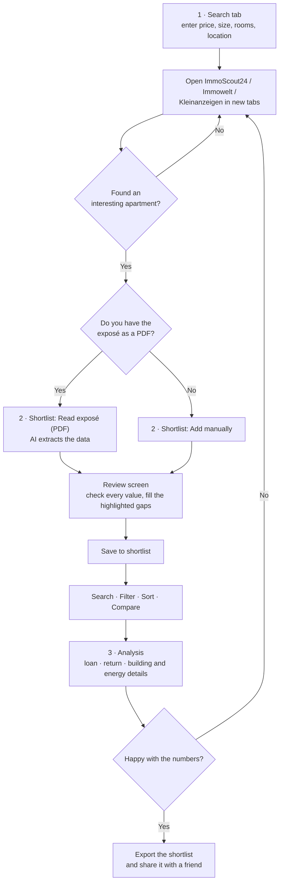
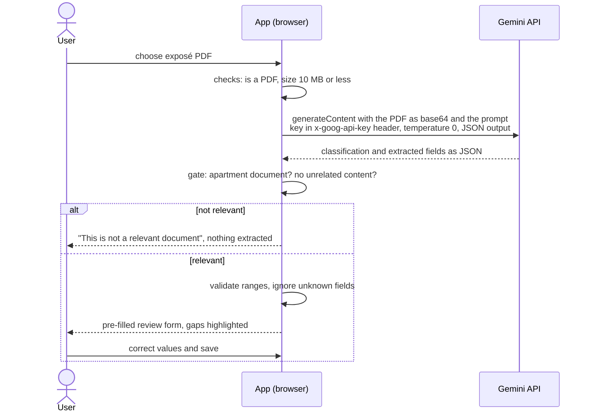

# Apartment Compass

A small web app that helps compare **apartments to buy in Germany**: set your requirements, jump to the big property portals with the right filters, keep a shortlist, let an AI read an exposé PDF into the form, and then run **loan** and **rental-return** analyses on each apartment.

> **How this was made:** this project is **vibe coding**. It was built in conversation with an AI coding assistant (**Claude Code**, by Anthropic). The product owner described the idea, made the key decisions and tested the result. The AI wrote the code. It is **not a one-person hand-coded project**, and the code has had no independent security or code audit. See [How it was built](#how-it-was-built-vibe-coding-with-ai).

No backend, no accounts, no scraping. It is a static website (HTML, CSS, JavaScript) that runs entirely in your browser.

---

## What it does

| Tab | What you can do |
|---|---|
| **1 · Search** | Enter state, city, price, size and rooms. The app builds the search link for ImmoScout24, Immowelt and Kleinanzeigen and opens it in a new tab. |
| **2 · Shortlist** | Add apartments manually or by **reading an exposé PDF with AI**. Search (from 2 characters), **Filter** (city, Stadtteil, sliders for price, size, cold rent total and per m², year built) and **Sort** (price, size, year built, net yield). |
| **3 · Analysis** | Loan: monthly payment, remaining debt after the fixed period, repayment table and chart, buying costs by federal state. Return: gross/net yield, cash flow, return on equity, break-even rent. Also living-in cost, building and energy-certificate details. |

The default interest rate is pulled live from the **Bundesbank** and can be edited.

## How to use it



### One-time setup for the AI reader (about 2 minutes)

1. Open <https://aistudio.google.com/apikey> and sign in with a Google account.
2. Create an API key (the free tier is enough) and copy it.
3. In the app click **⚙ AI settings**, paste the key and click **Save & test**.
4. You should see "✓ Key and model work". Then use **Shortlist → 📄 Read exposé (PDF)**.

## How it was built (vibe coding with AI)

- **Tool:** Claude Code (Anthropic's AI coding assistant), used as a conversation partner that writes, runs and tests code.
- **Human role (product owner):** defined the problem and users, set requirements step by step, asked for feasibility and legal checks *before* building, chose the data approach, decided on the safeguards for the AI feature, tested the app with real exposés, and steered every iteration.
- **AI role:** researched options, wrote essentially all the code, and tested its own work in a browser (hand-checked loan and yield figures, stubbed API tests for the guard rails).
- **What this does not mean:** the owner did not review every line of code, and there is no automated test suite or independent audit. Treat it as a well-tested prototype, not production software.

The decisions below were made by the product owner in dialogue with the AI, and are the interesting part of the project:

| Decision | Choice |
|---|---|
| Where do listings come from? | **No scraping.** Portals forbid automated access, and the legal risk is real (terms of use, database rights). The app only opens the portals' own search pages and works from the exposé the user brings back. |
| How is the AI paid for? | The user's **own free Gemini API key**, kept in their browser. No shared key, no server, no cost to the owner. |
| What may the AI read? | **Only apartment-for-sale PDFs.** Anything else is rejected. |
| Who is in charge of the numbers? | The **human**, via a review screen before anything is saved. The AI only fills the form. |

## AI governance: how the AI is controlled

The AI is used for one narrow job: **reading an exposé PDF and proposing values for a form**. It does not calculate, rank or recommend. All maths is plain, deterministic code.

| Principle | How it is implemented |
|---|---|
| **Human in the loop** | Extracted values open in an editable form. Nothing is saved until the user checks and clicks Save. A banner says "Filled in by AI… check every value". |
| **Scope restriction** | The model must first classify the document. Only an apartment-for-sale document passes. Invoices, CVs, tax papers, rental ads, houses and land are rejected with the message "This is not a relevant document", and nothing is extracted. Documents that mix in unrelated content are rejected too. |
| **No invention** | The prompt allows only values explicitly stated in the document. Unknown fields stay empty and are highlighted. The AI never estimates rent. |
| **Output validation** | Every number is range-checked (for example size 10 to 1000 m², price 10k to 30M €). Implausible values are dropped and flagged. Strings are length-limited and always rendered as plain text, never as HTML. |
| **Prompt-injection defence** | The PDF is declared untrusted data in the system instruction. The model's answer is parsed as JSON and only known fields are read, so text hidden in a PDF cannot trigger other actions. |
| **Input checks before upload** | Only real PDFs (checked by file signature), non-empty, at most 10 MB. Nothing else leaves the browser. |
| **Data minimisation and privacy** | No backend, no database, no analytics. The PDF goes straight from the browser to Google. The first upload asks for confirmation, and the app warns that Google may use free-tier content to improve its products, so only public listings should be uploaded. |
| **Credential handling** | The API key is stored only in the user's browser (localStorage), sent in a request header (never in a URL), and excluded from Export. There is a "Remove key" button. |
| **Separation of AI and analysis** | Loan and return calculations are deterministic and were checked by hand against known values. The AI cannot change them. |
| **Graceful failure** | Friendly messages for invalid key, quota exhausted, blocked content, timeouts and unreadable answers. |
| **Transparency and disclaimers** | The footer states this is not financial, tax or legal advice. Tax effects are not modelled. The app is not affiliated with any portal. |

**Known gaps (honest list):** the model can still misread a table (hence the review step); a key in localStorage is exposed if the site were ever compromised; free-tier quotas and model names change without notice; there is no usage logging or audit trail; no automated tests.

## How the APIs are used

The app calls two external APIs, both directly from the browser:

**1. Google Gemini API** (exposé reading)



- Endpoint: `POST https://generativelanguage.googleapis.com/v1beta/models/{model}:generateContent`
- The PDF is sent inline as base64. The request uses a system instruction (rules and untrusted-data warning), `temperature: 0` and `responseMimeType: application/json`.
- The model name is editable in settings (default `gemini-3.6-flash`), because free models change.
- Chosen because Google's free tier accepts PDFs natively and needs no payment details. The prompt and parsing live in [`js/ai.js`](js/ai.js).

**2. Bundesbank statistics API** (default mortgage rate)

- Series `BBIM1.M.DE.B.A2C.P.R.A.2250.EUR.N`: average effective interest rate, new business, housing loans to households, initial rate fixation over 10 years.
- It is a **market average**, not a bank offer, and the UI says so. The value can be overridden.

## Run it

Open `index.html` in a browser, or serve the folder:

```bash
python3 -m http.server 8765
```

then open <http://localhost:8765>. To share it, upload the folder to any static host (Netlify Drop, Cloudflare Pages, GitHub Pages). Each person keeps their own shortlist in their own browser. Use **Export / Import** to pass a shortlist on.

## Project structure

```
index.html     page layout and dialogs
styles.css     styling (light and dark mode, mobile friendly)
js/calc.js     loan, buying costs, yield and cash-flow maths (pure functions)
js/ai.js       Gemini exposé reader with the relevance gate and validation
js/app.js      UI: search links, shortlist, filter/sort, analysis, settings
```

## Legal and disclaimers

- Informational calculator only. **Not financial, tax or legal advice**, and not a loan or property offer.
- Taxes (income tax on rent, depreciation, the 10-year speculation period) are not included.
- Portal search URL formats are unofficial and may change.
- Not affiliated with ImmoScout24, Immowelt, Kleinanzeigen, Google or the Bundesbank.
